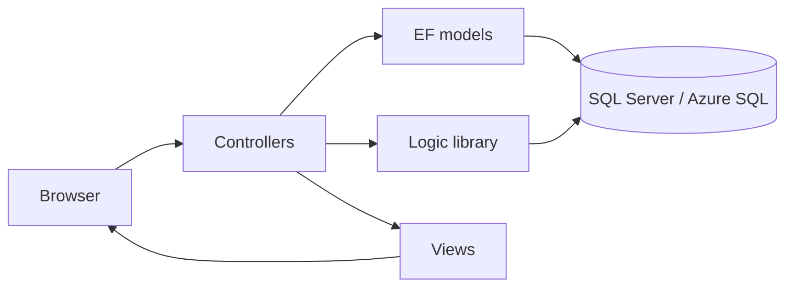

<p align="center">
  
</p>

<h1 align="center">PhotoArt</h1>

<p align="center">
  <em>Your memories, online.</em>
</p>

<p align="center">
  
  
  
  
  
  
  
</p>

PhotoArt is a collaborative university project developed by
[BegoMdeMM](https://github.com/BegoMdeMM) and
[Jose Ángel Gumiel](https://github.com/jagumiel). It explores how to build and
deploy an online photo-album application using the Model–View–Controller
pattern, Visual Basic .NET, ASP.NET MVC and Microsoft Azure.

The application lets users register, sign in, create albums with different
visibility levels, upload photographs and browse their collections. Beyond
those features, the repository documents an early end-to-end web-development
exercise: user interface, request routing, domain models, persistence,
role-specific areas and cloud deployment.

> [!CAUTION]
> **This is a legacy educational prototype, not a production-ready service.**
> It targets Visual Studio 2012, .NET Framework 4.5, ASP.NET MVC 4 and
> dependencies from the same period. The code contains confirmed security
> weaknesses and must not be exposed to the Internet or connected to real
> data without a thorough redesign.

> [!IMPORTANT]
> Historical Azure SQL credentials are committed in the repository. They must
> be treated as compromised and revoked or rotated if they have not already
> been disabled. Removing them from the current files is not sufficient because
> Git preserves previous revisions.

## What the project demonstrates

- A server-rendered web application organised around ASP.NET MVC.
- Visual Basic .NET controllers, models and views.
- Database-first modelling with Entity Framework 5 and EDMX files.
- A separate class library for album, photograph, user and database logic.
- Registration, sign-in and session-based navigation.
- Member and administrator areas.
- Creation of public, limited and private album categories.
- Multipart image uploads and photograph-to-album associations.
- SQL Server/Azure SQL persistence.
- A historical deployment to Microsoft Azure.

The repository is especially useful as a record of how a complete web
application was approached with the Microsoft stack of its time. It should be
studied critically: some architectural ideas remain valuable, while the
framework versions and several security decisions do not meet current
requirements.

## Visit the site!
Do you want to see how this project looks? Visit [PhotoArt](http://photoart.azurewebsites.net/)!

## MVC at a glance



| MVC responsibility | PhotoArt implementation |
| --- | --- |
| **Model** | `Usuarios` and `Albumes` entities generated from the EDMX database models |
| **View** | ASPX and VBHTML templates for the home, account, member and administrator interfaces |
| **Controller** | `HomeController`, `UsuarioController`, `SocioController` and `AdminController` |
| **Application logic** | `BibliotecaDeFunciones`, a separate Visual Basic class library |
| **Persistence** | Entity Framework plus legacy ADO.NET/`SqlClient` operations against SQL Server |

For example, creating an album starts in
`Views/Socio/FormNuevoAlbum.aspx`, is handled by `SocioController`, passes
through `Album_Logic` and is finally persisted in SQL Server. The same
separation is used for registration, sign-in and photograph uploads, although
some responsibilities are mixed because this was an exploratory academic
prototype.

## User journeys

### Visitor

1. Open the public landing page.
2. Register a new account.
3. Sign in with an email address and password.

### Member

1. Enter the member area.
2. Create an album and select an access category.
3. List personal albums.
4. Select an album and view its photograph records.
5. Upload new images to the selected album.

### Administrator

1. Enter the administrator area after sign-in.
2. Inspect the user-management view.

These flows describe the project's intent and existing screens. They are not a
claim that the current authorization or privacy controls are secure.

## Repository structure

```text
PhotoArt/
├── AlbumFotos.sln
├── AlbumFotos/                     # ASP.NET MVC web application
│   ├── App_Data/                   # Legacy local database artifacts
│   ├── App_Start/                  # Routes, filters, bundles and auth setup
│   ├── Controllers/                # MVC request handlers
│   ├── Models/                     # EF Database First models and entities
│   ├── Views/                      # ASPX/VBHTML user interface
│   ├── Content/                    # Application styles
│   ├── Scripts/                    # Historical client-side dependencies
│   ├── Images/                     # Branding, sample and uploaded images
│   ├── Web.config                  # Legacy application configuration
│   └── AlbumFotos.vbproj
├── BibliotecaDeFunciones/          # Data-access and application-logic library
├── packages/                       # Versioned legacy NuGet packages
├── README.md
└── LICENSE
```

The solution contains two projects:

| Project | Type | Purpose |
| --- | --- | --- |
| `AlbumFotos` | ASP.NET MVC web application | Controllers, views, EF models, static assets and web configuration |
| `BibliotecaDeFunciones` | Visual Basic class library | User, album, photograph and SQL data-access operations |

## Technology snapshot

| Area | Technology in the repository |
| --- | --- |
| IDE | Visual Studio 2012 |
| Language | Visual Basic .NET |
| Runtime | .NET Framework 4.5 |
| Web framework | ASP.NET MVC 4 |
| Data access | Entity Framework 5 and ADO.NET `SqlClient` |
| Database | SQL Server / historical Azure SQL |
| Views | ASPX Web Forms view engine, with one Razor VBHTML view |
| Client side | jQuery 1.8.2, jQuery UI 1.8.24, Knockout 2.2 and Modernizr 2.6.2 |
| Hosting | Microsoft Azure, historically |
| Package format | NuGet `packages.config` |

## Security status

The repository has not undergone a complete penetration test, but source review
already identifies multiple issues that prevent safe deployment.

| Finding | Why it matters | Required remediation |
| --- | --- | --- |
| Database credentials committed to source control | Anyone with repository history may possess the secret | Revoke or rotate the credential first; move new secrets to a secure configuration provider and then clean the history |
| SQL statements assembled by string concatenation | User-controlled values can alter database queries | Replace raw concatenation with parameterised commands or safe ORM queries |
| Plain-text and unsalted MD5 password handling | Passwords can be exposed or recovered too easily | Replace the custom flow with a supported identity system and adaptive password hashing |
| Incomplete server-side authorization | Session values and navigation alone do not protect controllers or resources | Enforce authentication, roles, ownership and album permissions on every protected action |
| Missing effective CSRF validation on state-changing actions | A third-party page may cause an authenticated browser to submit unwanted requests | Use anti-forgery tokens in the views and validate them in every corresponding POST action |
| Unrestricted file uploads | Names, size and content are not adequately validated; files are stored beneath the web application | Allow only verified image formats, generate server-side names, limit size, scan content and store uploads outside the executable web root |
| Visibility represented mainly by folders and labels | A `Private` path is not an access-control decision | Serve protected images through an authorised endpoint or private object storage |
| Obsolete framework and JavaScript packages | Unsupported dependencies no longer receive normal security maintenance | Migrate to a currently supported .NET release and update or remove client dependencies |
| Debug-oriented and generated artifacts committed | Configuration, databases, build outputs or sample uploads may reveal sensitive data | Audit and remove `App_Data`, `bin`, `obj`, restored packages and user-generated content from version control |

The repository also contains overlapping authentication scaffolding and custom
session-based code. A modernisation should choose one identity system rather
than attempting to repair both approaches independently.

### Immediate containment

1. Revoke or rotate the exposed database credential.
2. Confirm that the historical Azure application and database are offline or
   access-restricted.
3. Audit the database files, uploaded images and Git history for personal data.
4. Do not reuse any password or secret that has appeared in this repository.
5. Add a security notice before accepting deployments or contributions.
6. Only after rotation, remove secrets from tracked files and decide whether to
   rewrite the Git history.

## Running the legacy code

Running the original application is only recommended inside an isolated
learning environment. Do not connect it to the historical cloud database, use
real credentials or expose it publicly.

### Historical prerequisites

- Windows.
- Visual Studio 2012 or another environment capable of targeting .NET
  Framework 4.5 and ASP.NET MVC 4.
- IIS Express.
- NuGet package restore support for `packages.config`.
- A disposable SQL Server instance with a newly created, least-privileged
  account.

### Basic workflow

```powershell
git clone https://github.com/jagumiel/PhotoArt.git
cd PhotoArt
nuget restore AlbumFotos.sln
```

Then:

1. Open `AlbumFotos.sln` in Visual Studio.
2. Replace every historical connection string with local, disposable
   configuration.
3. Recreate the required user, album and photograph schema.
4. Ensure the image-upload directories exist and are not executable.
5. Start the `AlbumFotos` project with IIS Express.

> [!NOTE]
> The main cloud database schema is represented by the EDMX models, but the
> repository does not provide a complete modern migration or reproducible
> database bootstrap. A clean clone may therefore require manual database work.
> The current code has not been validated against a modern Visual Studio or
> .NET toolchain.

## Modernisation roadmap

### Phase 0 — Preserve and contain

- Tag the original application as a legacy release.
- Disable or isolate any remaining public deployment.
- Rotate exposed credentials and inspect the repository for personal data.
- Add a Visual Studio `.gitignore` and stop tracking build outputs, restored
  packages, local databases and uploaded files.

### Phase 1 — Establish a secure baseline

- Create a new project on a supported .NET LTS release.
- Replace custom authentication with ASP.NET Core Identity.
- Define explicit roles, ownership rules and album-access policies.
- Store secrets outside source control using development secrets and a managed
  secret store in production.
- Add central error handling, secure headers, HTTPS enforcement and structured
  logging.

### Phase 2 — Rebuild the data layer

- Replace the EDMX models and hand-built SQL with Entity Framework Core.
- Introduce migrations and a reproducible development database.
- Use parameterised queries for any operation that cannot use the ORM.
- Model users, albums, photographs and sharing permissions explicitly.
- Add data-retention and account-deletion behaviour.

### Phase 3 — Secure image handling

- Validate file signatures as well as extensions and MIME types.
- Apply strict file-size, pixel-dimension and resource limits.
- Generate random object names instead of trusting client filenames.
- Re-encode images and remove unnecessary metadata.
- Store files outside the application tree or in private object storage.
- Authorise each download and use time-limited URLs where appropriate.

### Phase 4 — Make quality measurable

- Add unit tests for domain and authorization rules.
- Add integration tests for registration, album ownership and uploads.
- Test CSRF protection and cross-user access.
- Enable dependency, secret and static-code scanning in CI.
- Build and test every pull request.

### Phase 5 — Recover the product experience

- Preserve the original PhotoArt identity and learning history.
- Rebuild the interface with accessible, responsive templates.
- Add thumbnail generation and pagination.
- Implement deliberate sharing rather than directory-based visibility.
- Publish a new deployment only after security review.

## Project status

PhotoArt is preserved as a historical academic project. Maintenance work should
focus first on containment and documentation; developing a secure `PhotoArt 2`
is preferable to incrementally exposing the legacy application.

Contributions that improve documentation, reproducibility or security analysis
are welcome. Please do not submit real credentials, personal photographs or
production datasets.

## Authors

PhotoArt is a joint project by:

- [BegoMdeMM](https://github.com/BegoMdeMM)
- [Jose Ángel Gumiel (`jagumiel`)](https://github.com/jagumiel)

The use of first-person plural in this documentation reflects that shared
authorship.

## Resumen en español

PhotoArt es un proyecto universitario colaborativo desarrollado con Visual
Basic .NET, ASP.NET MVC 4, Entity Framework 5, SQL Server y Microsoft Azure. La
aplicación explora el patrón Modelo–Vista–Controlador mediante el registro de
usuarios, la creación de álbumes y la subida de fotografías.

El repositorio se conserva por su valor formativo e histórico, pero el código
actual **no debe desplegarse en producción**. Contiene credenciales antiguas,
consultas SQL no parametrizadas, tratamiento inseguro de contraseñas, controles
de autorización incompletos y subidas de archivos insuficientemente validadas.
La prioridad es revocar los secretos expuestos y mantener cualquier ejecución
en un entorno aislado.

## License

This project is distributed under the [MIT License](LICENSE). Copyright is
shared by the two project authors.
